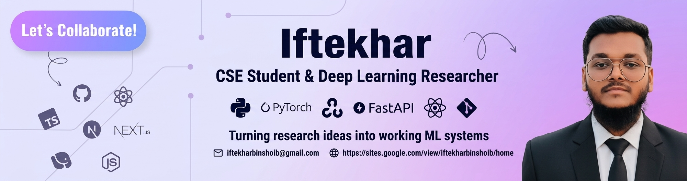

  

  

  

 

<h2>🚀 About Me</h2>

  
  
  

I'm a final-year Computer Science and Engineering student at **American International University-Bangladesh**. I build full-stack web applications first, and I pair them with applied deep learning research. I care about products that solve real problems, from a market-price tracker for everyday shoppers to an AI security system for residential buildings.

<table>
  <tr>
    <td width="33%" valign="top">
      <h4>🌐 Full-Stack Web</h4>
      Next.js, React and TypeScript on the front end. Node.js, Express and NestJS with MongoDB and PostgreSQL on the back end. Authentication, protected routes and responsive, Bengali-first interfaces.
    </td>
    <td width="33%" valign="top">
      <h4>🛡️ Currently Building</h4>
      <b>VisionGuard</b>, an AI "digital watcher" that plugs into a building's existing cameras. Selected for Round 2 of the Grameenphone Future Maker Hackathon.
    </td>
    <td width="33%" valign="top">
      <h4>🔬 AI Research</h4>
      Computer vision and explainable AI, plus gene-expression network analysis with GNNs. Co-authored an urban waste detection paper submitted to ICCA 2026.
    </td>
  </tr>
</table>

 

<h2>💻 Featured Web Projects</h2>

 

### 🛡️ VisionGuard

A centralized AI "digital watcher" that turns the ordinary cameras a building already has into intelligent security and safety monitoring. It plugs into an existing DVR/NVR, so residents change nothing about their setup.

- 🏆 Selected for **Round 2** of the Grameenphone Future Maker Hackathon
- 🧠 Planned detection models: people, children, fighting and weapons, with custom-annotated datasets
- 🏢 The demo UI covers areas, alerts and settings, with setup import/export
- 📷 Works with a live mobile phone camera or any IP camera

 

### 🛒 BazarDor (বাজার দর)

A Bangla market-price tracker for everyday essentials: rice, lentils, oil, vegetables, fish, meat, eggs, dairy and spices.

- 📈 Live price ticker and "today's price movers" (risers and fallers, color-coded)
- 🏪 Price comparison across 12 markets, with lowest / highest / average and yesterday, last week and last month
- 🔐 Authentication with Better Auth + MongoDB (email/password, Google, GitHub) and protected routes
- 🔍 Product search, category pages with numeric sorting (Bengali digits included), and light/dark mode
- 🛡️ Automatic API fallback: tries two backup APIs before showing a friendly Bangla error
- 🇧🇩 Bengali-first, fully responsive UI

 

<h2>🧪 Research & Other Projects</h2>

| Project | Description |
|---|---|
| 🗑️ **Urban Waste Detection** | Object detection with YOLO26 / RT-DETR-L / Faster R-CNN on a self-collected ~12k-image, 9-class Bangladesh waste dataset, with Grad-CAM++ / Eigen-CAM explainability. Submitted to ICCA 2026, now being extended into a second paper. |
| 🍆 **Brinjal Disease Classification** | Hybrid CNN feature-fusion model (~90.9% test accuracy) benchmarked against the BrinjalFruitX reference paper, with duplicate-aware, leakage-free splits. Paper in progress. |
| 🧬 **Gene-Expression Network Thesis** | Gene co-expression network topology and explainable GNNs for biomarker discovery in autoimmune disease (SLE). |
| 🔐 **Face Verification System** | Real-time face verification (YuNet + SFace) that triggers an Arduino-controlled door lock over serial. |

 

<h2>🛠️ Tech Stack</h2>

 

**Languages**

**Full-Stack Web Development**

**ML / Deep Learning / Computer Vision**

**Tools & Platforms**

 

<h2>📊 GitHub Statistics</h2>

 

  
  

  

 

  <picture>
    <source media="(prefers-color-scheme: dark)" srcset="https://raw.githubusercontent.com/IFTI737/IFTI737/output/github-contribution-grid-snake-dark.svg">
    <source media="(prefers-color-scheme: light)" srcset="https://raw.githubusercontent.com/IFTI737/IFTI737/output/github-contribution-grid-snake.svg">
    
  </picture>

 

<h2>📫 Connect With Me</h2>

 

  
  
  

