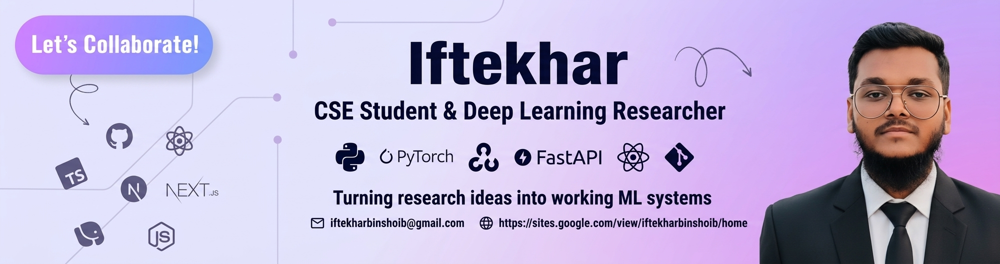

  

  

  

 

<h2>🚀 About Me</h2>

  
  
  
  

I'm a **Full-Stack and AI developer** studying Computer Science and Engineering at **American International University-Bangladesh** (CGPA 3.79, Dean's List). I build end-to-end web applications with Next.js, NestJS and PostgreSQL, and pair them with Computer Vision and NLP work in Python. I've shipped an AI security platform, a Bangla language analysis tool and a full-stack booking marketplace, and I like turning ideas into practical products.

<table>
  <tr>
    <td width="33%" valign="top">
      <h4>🌐 Full-Stack Web</h4>
      Next.js, React and TypeScript on the front end. Node.js, NestJS, Express and FastAPI with PostgreSQL, MongoDB and Redis on the back end. JWT and OAuth authentication, job queues, and real-time features with WebSockets and WebRTC.
    </td>
    <td width="33%" valign="top">
      <h4>🛡️ Currently Building</h4>
      <b>VisionGuard</b>, an AI platform that turns existing CCTV cameras into 24/7 monitoring for homes, farms, shops and construction sites. Semi-Finalist at Grameenphone Future Maker 2026.
    </td>
    <td width="33%" valign="top">
      <h4>🔬 AI Research</h4>
      Undergraduate research under faculty supervision: object detection, explainable AI (Grad-CAM++, Eigen-CAM) and CNN fusion models for plant disease classification.
    </td>
  </tr>
</table>

 

<h2>💻 Featured Projects</h2>

 

### 🛡️ VisionGuard

An AI platform that turns existing CCTV cameras into 24/7 monitoring for homes, farms, shops and construction sites. I created the product, lead the team and designed the full system architecture.

- 🏆 **Semi-Finalist, Grameenphone Future Maker 2026**
- ⚙️ NestJS + PostgreSQL REST API with a rule engine, incident grouping and risk scoring
- 🚨 Alert chain that escalates from in-app alerts to Telegram to phone calls until someone responds
- 🧠 Live v1 prototype with in-browser YOLOv8n person detection, owner-drawn restricted zones and active hours
- 📡 Telegram Bot snapshot alerts and live WebRTC camera streaming
- 👥 Role-based team access and Redis/BullMQ job queues

 

### 💬 অনুভূতি · Bangla Sentiment Pro

A full-stack NLP platform for **Bangla and Banglish** text. It detects the script and routes each input to one of three transformer models I fine-tuned, then returns the sentiment, six emotion scores and the words that carried them.

- 🧠 Three fine-tuned models: BERT, BanglaBERT and XLM-RoBERTa
- 🎯 ~91% sentiment accuracy, and 6-class emotion classification (~70% Bangla, ~62% Banglish)
- 🔎 Word-level explanations that show how much each word mattered
- 📊 Bulk CSV analysis (product reviews, customer feedback), YouTube comment analysis and a mood journal
- ⚙️ Next.js frontend on Vercel and a Dockerized FastAPI backend on Hugging Face Spaces, with a public REST API

 

### 📸 StudioSpace

A full-stack marketplace where creators book photo, film, podcast and music studios by the hour, and hosts list and manage their spaces.

- 🕒 Double-booking prevention with a MongoDB time-overlap query
- ⭐ Reviews with recalculated ratings, a saved-studios wishlist and PDF invoices
- 🔐 Better Auth (email login and Google sign-in through Google Cloud OAuth) with JWT-protected REST APIs

 

<h2>🧪 Research & Other Projects</h2>

| Project | Description |
|---|---|
| 🗑️ **Urban Waste Detection with Explainable AI** | Curated and annotated a ~12,000-image, 9-class waste dataset from Bangladesh. Benchmarked YOLO26, RT-DETR-L and Faster R-CNN (best: RT-DETR-L, ~83.4% mAP@0.50) and explained model errors with Grad-CAM++ and Eigen-CAM. |
| 🍆 **Brinjal Fruit Disease Classification** | Benchmarked 7 CNN backbones and a custom fusion hybrid (DenseNet121 + MobileNetV2) on BrinjalFruitX: 91.26% accuracy vs. an 80.0% baseline. |
| 🌾 **Smart Crop Recommendation System** | ML model that recommends crops from soil and weather inputs, served through a FastAPI backend designed for ESP32 sensor data. Python, scikit-learn, FastAPI, ESP32. |
| 🧬 **Gene-Expression Network Thesis** | Gene co-expression network topology and explainable GNNs for biomarker discovery in autoimmune disease (SLE). |
| 🔐 **Face Verification System** | Real-time face verification (YuNet + SFace) that triggers an Arduino-controlled door lock over serial. |

 

<h2>🏆 Achievements & Leadership</h2>

 

- 🥇 **Semi-Finalist, Grameenphone Future Maker 2026**: pitched VisionGuard, an AI-powered CCTV security platform
- 🎓 **Dean's List Honors** at AIUB, with a 3.84/4.00 semester GPA in Spring 2023–2024 and a CGPA of 3.79/4.00
- 👥 **Team Leader** in every university course project: distributed tasks, coordinated members, managed deadlines and led presentations
- 🤝 **Volunteer, Feni Flood Relief (2024)**: delivered food and supplies to remote areas
- 📘 **Programming Hero**: AI-Driven Full-Stack Web Development (in progress, expected Dec 2026)

 

<h2>🛠️ Tech Stack</h2>

 

**Languages**

**Full-Stack Web Development**

**Databases & Queues**

**AI / Machine Learning / Computer Vision**

**Tools & Platforms**

 

<h2>📊 GitHub Statistics</h2>

 

  
  

  

 

  <picture>
    <source media="(prefers-color-scheme: dark)" srcset="https://raw.githubusercontent.com/IFTI737/IFTI737/output/github-contribution-grid-snake-dark.svg">
    <source media="(prefers-color-scheme: light)" srcset="https://raw.githubusercontent.com/IFTI737/IFTI737/output/github-contribution-grid-snake.svg">
    
  </picture>

 

<h2>📫 Connect With Me</h2>

 

  
  
  

